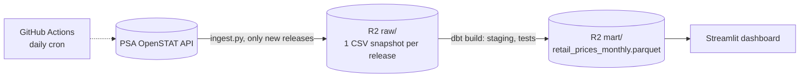

# Agri-Price Intelligence Platform

Monthly retail food prices for the Philippines (national, 18 regions and 100 provinces and cities, 197 commodities, from January 2018) from the Philippine Statistics Authority. A daily job stores each PSA release unchanged on Cloudflare R2, a dbt project models and tests it, and a Streamlit dashboard shows the result. It costs $0 to run.



## How it works
- **Ingest** (`src/etl/ingest.py`): one GET lists PSA's 11 retail price tables with their `updated` time. A table is downloaded only when R2 doesn't have that release yet, checked with a single HEAD. A day with no new release makes 1 PSA call and 11 HEADs.
- **Raw** (`raw/table=<id>/updated=<YYYYMMDDTHHMMSS>.csv`): each table exactly as PSA returned it, never rewritten. PSA revises past months, so keeping every release makes each number traceable to its source.
- **Model** (`dbt/`, dbt Core + dbt-duckdb):
  - `stg_psa__retail_prices` unpivots the month columns of the latest two snapshots per table.
  - `int_retail_prices` adds PSGC geo codes from a seed.
  - `retail_prices_monthly`, keyed on `(month, geo_code, commodity)`, is written to R2 as Parquet.
- **Tests that block publishing**:
  - a table or geolocation is missing, or PSA adds an unknown one
  - duplicate keys
  - `price <= 0`
  - a release with far fewer filled cells than the one before

  All tests run upstream of the mart, so a failure skips the write and R2 keeps the last good mart. A latest month more than 3 months old only warns.
- **pytest** covers ingest (change detection, HEAD-only R2 checks, rejecting non-CSV responses), the pipeline's dbt trigger and the dashboard's data layer, all without network.
- **Dashboard** (`src/dashboard/`): a price trend per commodity and a region/province comparison for one month. It fetches the 3 MB mart in a single request.
- **$0 on R2**: a month has 11 snapshot writes, 1 mart write and about 30 HEADs a day, well inside the free tier. See `docs/cloudfare-agent-notes/free-tier-r2.md`. The reasons behind each tool are in `docs/adr.md`; the terms are defined in `GLOSSARY.md`.

## Run it
Needs [uv](https://docs.astral.sh/uv/). Copy `.env.example` to `.env` and fill in an R2 bucket and API token.

```bash
uv sync
uv run python -m pre_commit install   # ruff + mypy on every commit
uv run python -m pytest               # no network
uv run python -m src.etl.pipeline     # ingest; dbt build only if PSA released something
uv run python -m src.etl.pipeline --build   # always run dbt
uv run python -m streamlit run src/dashboard/app.py
```

dbt on its own, from the repo root:

```bash
uv run python -m dbt.cli.main build --project-dir dbt --profiles-dir dbt
# against a local copy of raw/ (needs <dir>/mart/ to exist):
uv run python -m dbt.cli.main build --project-dir dbt --profiles-dir dbt --vars "{lake_root: '<dir>'}"
```

## Sample queries
`src/etl/query.py` runs read-only SQL over the `raw` and `mart` views:

```bash
# National well-milled rice, last 12 months
uv run python -m src.etl.query "SELECT month, price FROM mart WHERE geo_code = '000000000' AND commodity = 'RICE, WELL-MILLED, 1 KG' ORDER BY month DESC LIMIT 12"

# Most expensive regions for one commodity in the latest month
uv run python -m src.etl.query "SELECT geolocation, price FROM mart WHERE geo_level = 'region' AND commodity = 'RICE, WELL-MILLED, 1 KG' AND month = (SELECT max(month) FROM mart) ORDER BY price DESC"

# Which release each table's latest snapshot comes from
uv run python -m src.etl.query "SELECT \"table\", max(updated) FROM raw GROUP BY ALL ORDER BY 1"
```

---
Data: [PSA OpenSTAT](https://openstat.psa.gov.ph/), Retail Prices of Agricultural Commodities by Geolocation, Commodity, Year and Period (2018 onward).
