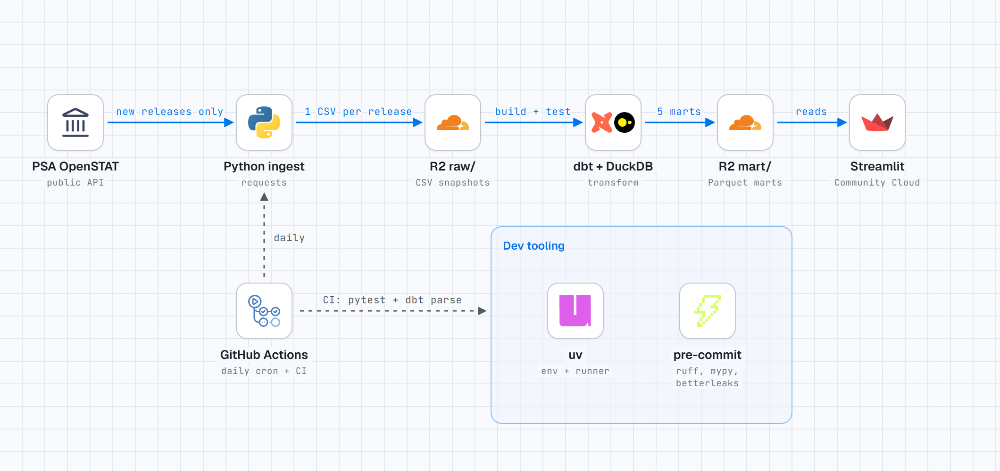

# PH Food Prices

How many centavos of every peso you pay at a Philippine store reach the farmer? This project answers that question from official data, and it runs for $0 a month.

**Live dashboard:** [ph-food-prices.streamlit.app](https://ph-food-prices.streamlit.app/)

<picture>
  <source media="(prefers-color-scheme: dark)" srcset="docs/stack-dark.png">
  
</picture>

## What it does
- Saves every Philippine Statistics Authority (PSA) release of retail, wholesale and farmgate food prices and the consumer price index (CPI), unchanged, so every number traces back to its source.
- Models and tests them with dbt. A failed test blocks publishing, so the dashboard keeps the last good data.
- Shows 25 everyday foods: the farmer's share of the store price, how much traders' cut grew since 2018 against inflation, and whether store prices come down when farm prices fall.
- Five dashboard pages: the story, who got caught, check your food, the short version, and how it's built.

## Stack
The reasons behind each choice are in [docs/adr.md](docs/adr.md).
- **Python + requests**: ingest from the PSA OpenSTAT API
- **Cloudflare R2**: raw CSV snapshots and Parquet marts
- **dbt + DuckDB**: staging, models and tests
- **Streamlit** on Streamlit Community Cloud: the dashboard
- **GitHub Actions**: the daily run and CI (pytest, dbt parse)
- **uv, pre-commit** (ruff, mypy, betterleaks): tooling

## Quick start
Needs [uv](https://docs.astral.sh/uv/). Copy `.env.example` to `.env` and fill in an R2 bucket and API token.

```bash
uv sync
uv run python -m pytest                              # offline
uv run python -m src.etl.pipeline                    # ingest; dbt runs if PSA released or a mart is stale
uv run python -m src.etl.pipeline --build            # always run dbt
uv run python -m streamlit run src/dashboard/app.py
```

## Project layout
```
src/etl/         ingest, pipeline, read-only query CLI
src/core/        storage settings (R2)
src/dashboard/   Streamlit app
dbt/             models, seeds, tests
tests/           pytest, no network
docs/            ADRs, pipeline detail, R2 free-tier notes
```

## Cost
$0 a month: a release day writes at most about 35 objects to R2, and ordinary days make about 30 HEAD requests, far inside the [free tier](https://developers.cloudflare.com/r2/pricing/).

## Docs
- [How the pipeline works](docs/pipeline.md): models, tests, dashboard pages, sample queries
- [Decisions](docs/adr.md)
- [Glossary](GLOSSARY.md)
- [dbt models](dbt/models/)

## Data and license
Data: [PSA OpenSTAT](https://openstat.psa.gov.ph/): retail prices of agricultural commodities (2018 onward), farmgate prices (`NFG`), wholesale selling prices (`NWSNEW`) and the CPI for all income households (2018=100).

Code: [MIT](LICENSE).
