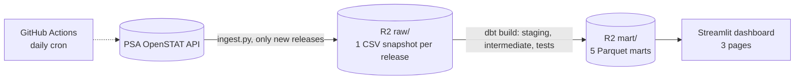

# PH Food Prices

Monthly retail food prices for the Philippines (national, 18 regions and 100 provinces and cities, 197 commodities, from January 2018) from the Philippine Statistics Authority. A daily job stores each PSA release unchanged on Cloudflare R2, a dbt project models and tests it, and a Streamlit dashboard shows the result. It costs $0 to run.

**Live dashboard:** [ph-food-prices.streamlit.app](https://ph-food-prices.streamlit.app/)



## How it works
- **Ingest** (`src/etl/ingest.py`): one GET per PSA folder lists the 11 retail price tables and the 8 farmgate tables used, with their `updated` time. A table is downloaded only when R2 doesn't have that release yet, checked with a single HEAD. A day with no new release makes 2 PSA calls and 19 HEADs.
- **Raw** (`raw/table=<id>/updated=<YYYYMMDDTHHMMSS>.csv`): each table exactly as PSA returned it, never rewritten. PSA revises past months, so keeping every release makes each number traceable to its source.
- **Model** (`dbt/`, dbt Core + dbt-duckdb):
  - `stg_psa__retail_prices` unpivots the month columns of the latest two snapshots per table.
  - `int_retail_prices` adds PSGC geo codes from a seed.
  - `retail_prices_monthly`, keyed on `(month, geo_code, commodity)`, is written to R2 as Parquet.
  - Three marts for the dashboard, built from seeds of 28 everyday foods (`staples.csv`) and sourced recipes (`recipes.csv`):
    - `staple_prices_monthly`: each food's price, its change in a month and a year, and its gap from the national price.
    - `dish_costs_monthly`: the cost of a dinner for 5, left blank where an ingredient is unpriced.
    - `staple_seasonality`: each food's usual price in a calendar month against its centred 13-month average.
  - `farmer_share_monthly`: for 18 staples, PSA's farmgate price over the retail price, by region and month (`stg_psa__farmgate_prices` → `int_farmer_share`). `dish_costs_monthly` also gives each dish's cost as a share of the region's daily minimum wage, from 2024 (`wage_orders.csv`, sourced from NWPC).
  - dbt tests recompute the year-on-year changes and dish costs by a separate path, and check prices against values fetched from PSA by hand (`psa_spot_checks.csv`).
- **Tests that block publishing**:
  - a table or geolocation is missing, or PSA adds an unknown one
  - duplicate keys
  - `price <= 0`
  - a release with far fewer filled cells than the one before

  All tests run upstream of the mart, so a failure skips the write and R2 keeps the last good mart. Two checks only warn: a latest month more than 3 months old, and a national price that doubles or halves in a month.
- **pytest** covers ingest (change detection, HEAD-only R2 checks, rejecting non-CSV responses), the pipeline's dbt trigger and the dashboard's data layer, all without network.
- **Dashboard** (`src/dashboard/`), 3 pages, each reading one group of marts and fetching each mart in a single request:
  1. **Overview**: the typical food's yearly change since 2019, every food's change this year, and what dinner costs.
  2. **Compare places**: a map of one food's price by province or region, with the cheapest and most expensive areas.
  3. **Look up a food**: any of PSA's 197 items in any place, with its trend, usual seasonal pattern and regional prices.
- **$0 on R2**: a release day has up to 19 snapshot writes and 5 mart writes, plus about 19 HEADs a day, well inside the free tier. See `docs/cloudfare-agent-notes/free-tier-r2.md`. The reasons behind each tool are in `docs/adr.md`; the terms are defined in `GLOSSARY.md`.

## Run it
Needs [uv](https://docs.astral.sh/uv/). Copy `.env.example` to `.env` and fill in an R2 bucket and API token.

```bash
uv sync
uv run python -m pre_commit install   # ruff + mypy on every commit
uv run python -m pytest               # no network
uv run python -m src.etl.pipeline     # ingest; dbt build only if PSA released something
uv run python -m src.etl.pipeline --build   # always run dbt
uv run python -m streamlit run src/dashboard/app.py
```

To rehearse the Streamlit Community Cloud deploy, paste the app's Secrets TOML into `.streamlit/secrets.toml` (gitignored) and run the dashboard. Its root-level keys become environment variables and take precedence over `.env`, as on the cloud.

dbt on its own, from the repo root:

```bash
uv run python -m dbt.cli.main build --project-dir dbt --profiles-dir dbt
# against a local copy of raw/ (needs <dir>/mart/ to exist):
uv run python -m dbt.cli.main build --project-dir dbt --profiles-dir dbt --vars "{lake_root: '<dir>'}"
```

## Sample queries
`src/etl/query.py` runs read-only SQL over the `raw` and `mart` views:

```bash
# National well-milled rice, last 12 months
uv run python -m src.etl.query "SELECT month, price FROM mart WHERE geo_code = '000000000' AND commodity = 'RICE, WELL-MILLED, 1 KG' ORDER BY month DESC LIMIT 12"

# Most expensive regions for one commodity in the latest month
uv run python -m src.etl.query "SELECT geolocation, price FROM mart WHERE geo_level = 'region' AND commodity = 'RICE, WELL-MILLED, 1 KG' AND month = (SELECT max(month) FROM mart) ORDER BY price DESC"

# Which release each table's latest snapshot comes from
uv run python -m src.etl.query "SELECT \"table\", max(updated) FROM raw GROUP BY ALL ORDER BY 1"
```

## What I'd build next
- **Wholesale step:** add PSA's wholesale price series between farmgate and retail, to show where along the chain the peso gap opens.
- **Revision tracker:** diff consecutive snapshots to show which past months PSA revised.
- **Inflation context:** join PSA's food CPI.

---
Data: [PSA OpenSTAT](https://openstat.psa.gov.ph/), Retail Prices of Agricultural Commodities by Geolocation, Commodity, Year and Period (2018 onward), and the Farmgate Prices tables (folder `NFG`). Minimum wages: [NWPC](https://nwpc.dole.gov.ph/).
